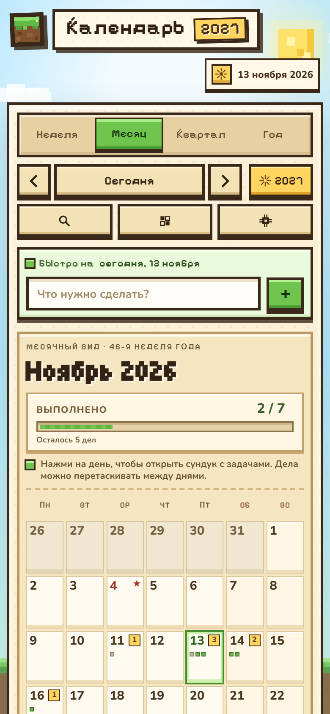
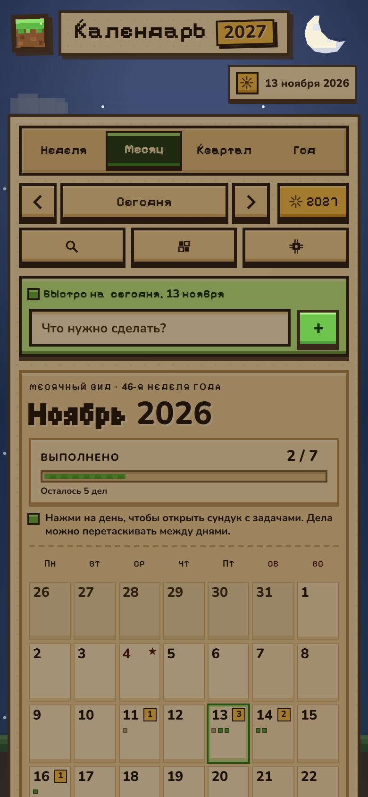
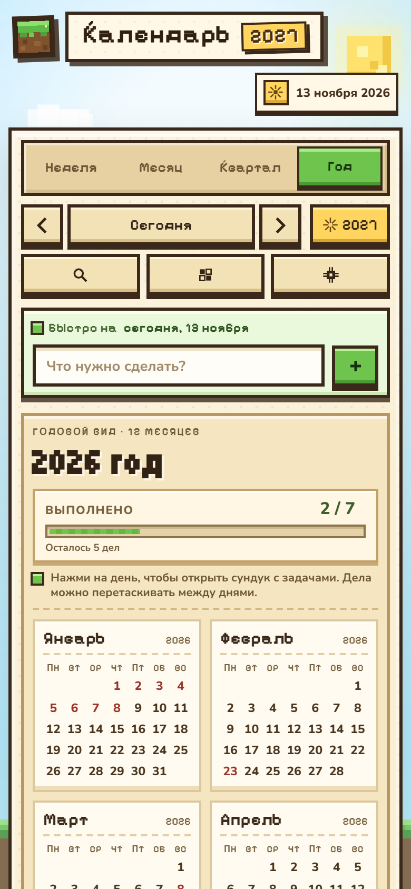
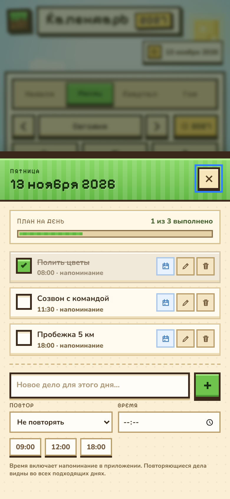

# Пиксельный календарь 2027

Милый календарь в духе Minecraft на чистом HTML, CSS и JavaScript — без сборки и зависимостей.

**Живое демо:** https://vladis77177.github.io/pixel-calendar-2027/ — открывается в браузере, ставится как PWA, данные остаются на устройстве.

| День | Ночь | Год | Окно дня |
|---|---|---|---|
|  |  |  |  |

## Как открыть

Самый простой способ: открыть `index.html` в браузере. Календарь работает и как обычный файл, но без установки приложения и офлайн-кэша.

Чтобы работали установка приложения (PWA), офлайн-режим и синхронизация телефона с компьютером, запустите домашний сервер из папки проекта:

```powershell
npm run sync
```

Он сам собирает `www/` и поднимает сервер на порту 8787, а в консоли печатает адреса («Локально» и «В сети») и код подключения. На компьютере откройте `http://localhost:8787` — установка приложения и service worker работают именно по этому адресу. Подробнее — в разделе «Синхронизация по локальной сети».

Если синхронизация не нужна, а хочется только установить приложение, годится любой статический сервер, например `npx serve .` или `python -m http.server 8000`: тогда открывайте `http://localhost:8000/`. Синхронизация с таким сервером не заработает — он не умеет `/api/state`.

## Что умеет

### Календарь

- Открывается на актуальной дате и подсвечивает сегодняшний день.
- Виды: неделя, месяц, квартал и весь год. На телефоне и планшете период листается свайпом влево/вправо.
- Быстрый переход к 2027 году.
- Праздники РФ: звёздочка в календаре и подпись в окне дня, отключаются в настройках.
- Прогресс выполнения для выбранного периода и для дня.
- Адаптивная вёрстка для телефона, планшета и компьютера.
- Поддержка клавиатуры: `←` / `→` — предыдущий / следующий период, `T` — сегодня, `N` — быстрый ввод, `/` — поиск, `Esc` — закрыть окно.

### Задачи

- Задачи по дням: добавить, отметить выполненной, переименовать, удалить.
- Перенос задачи на другую дату прямо в окне редактирования.
- Перетаскивание обычных задач между днями в видах «Неделя» и «Месяц».
- Быстрая строка добавления на выбранный день.
- Повторяющиеся дела: каждый день, по будням, каждую неделю, каждый месяц, каждый год; с необязательной датой окончания.
- У повторов независимые отметки и удаления для каждого дня; можно изменить всю серию или удалить один день / всю серию.
- Всё сохраняется автоматически в `localStorage` браузера (ключ `pixel-calendar-2027-v1`, схема данных `version: 4`).
- Удаление не теряется случайно: внизу на 6 секунд появляется тост с кнопкой «Отменить», и запись возвращается.
- «Перенести незавершённое на завтра» в окне дня разом отправляет все невыполненные обычные дела на следующий день (у дел со временем напоминание пересчитывается).
- Быстрая строка понимает обычный текст: «завтра 15:00 позвонить маме», «в пятницу в 9 утра», «через 3 дня в 12.12», «12 декабря 2027».
- Стереть всё можно двумя способами: «Удалить все задачи» (мягко, с защитой от воскрешения при синхронизации) и «Стереть безвозвратно» (с подтверждением словом, чистит и серверную копию).

### Напоминания

- У обычной задачи и у повторяющейся серии можно указать время — тогда в APK придёт системное уведомление.
- «Заранее» (10 минут, час или день) сдвигает это единственное уведомление; в тексте остаётся реальное время дела. Если момент уже прошёл, напоминание придёт в срок.
- «Отложить на час» важнее «заранее»: отложенное напоминание приходит ровно в выбранный момент.
- Утренняя сводка — одно уведомление со списком дел на день, время выбирается в настройках (по умолчанию 08:00). Включается в настройках APK.
- Напоминание само снимается при выполнении, удалении задачи или переносе на прошедшее время; после правки расписание пересобирается.
- Для серии уведомления планируются на 60 дней вперёд, а также на её ближайшее вхождение за пределами окна — годовой повтор не потеряется. Выполненные и удалённые дни пропускаются; расписание продлевается при следующем открытии приложения.
- В системном уведомлении APK есть кнопки «Готово» и «Отложить на час». Действие срабатывает даже при закрытом приложении, после него расписание обновляется.
- В браузере системных напоминаний нет — они работают только в установленном Android-приложении.

### Повторяющиеся дела

- Серия живёт по дням: отметка, перенос и удаление хранятся отдельно для каждого дня.
- В настройках, в разделе «Серии: подряд и история», у каждой серии видно счёт: сколько отмечено подряд, лучшая серия и сколько всего сделано. Рядом история за 10 недель клетками: зелёная — сделано, жёлтая — пропущено, светлая — по расписанию дня не было.
- В окне дня рядом с полем времени есть кнопки 09:00, 12:00 и 18:00.
- В настройках, в разделе «Быстрые дела», хранится список частых дел: в окне дня они добавляются одним нажатием.

### Поиск

- Поиск по названию по всем дням.
- Фильтры по статусу (все / в планах / готово) и типу (обычные / повторяющиеся).
- Переход из результата сразу к нужному дню.

### Данные и Google Календарь

- Экспорт резервной копии в JSON и импорт обратно.
- Экспорт всех дел в файл `.ics` для Google Календаря (повторы становятся сериями событий).
- Кнопка календаря у каждой задачи — быстрое добавление события в Google Календарь.
- Полная очистка данных и отдельная кнопка «Стереть безвозвратно» с двойным подтверждением: удаляет и локальные данные, и серверную копию, если синхронизация настроена.

### Приложение и виджет

- PWA: манифест, иконки, service worker, установка на главный экран, офлайн-режим.
- Компактная страница `widget.html` — мини-виджет «Сегодня» с часами, прогрессом, списком дел и быстрым добавлением; днём светлая бумага, ночью — тёмная с луной.
- Виджет главного экрана Android в том же стиле: пиксельные рамки, шрифт Tiny5, счётчик «сделано / всего», праздник и быстрые отметки; тап по строке обычного дела отмечает его выполненным прямо в виджете (серии отмечаются в приложении — у них отдельное состояние на каждый день); тема дня/ночи выбирается по времени суток и настройке неба.
- Обновления обеих форм: плашка о новой версии в PWA и в APK, установка поверх без потери данных.
- Ярлыки быстрого добавления: зажмите иконку приложения (Android) или щёлкните правой кнопкой по ярлыку PWA — «Добавить дело» открывает нужный день сразу с полем ввода; «Завтра» — окно завтрашнего дня; «Сейчас» подставляет ближайший получас.
- Отмена удаления: после удаления дела тост держит «Отменить» 6 секунд; кнопка «Перенести незавершённое на завтра» в окне дня переезжает вместе с напоминаниями.

### Синхронизация по локальной сети

Домашний сервер без облаков и аккаунтов: компьютер и телефон обмениваются данными через Wi-Fi. Интернет не нужен, данные не покидают квартиру.

**Что понадобится:** компьютер и телефон в одной Wi-Fi-сети, Node.js на компьютере, установленный календарь на телефоне (PWA или APK).

**На компьютере**

1. Откройте терминал **в папке проекта** — та, где лежит `package.json` (например, `cd H:\kalendar`). Никакие другие серверы не годятся: `npx serve`, `python -m http.server` и подобные отдают файлы, но не умеют `/api/state`, поэтому синхронизации в них нет, а в чужой папке они покажут просто список файлов.
2. Выполните `npm run sync`. Команда сама пересоберёт `www/` и поднимет сервер на порту 8787. Окно терминала должно оставаться открытым: закрыли — синхронизация остановилась. Остановить — `Ctrl+C`.
3. Разрешите Node.js доступ к частной сети, если Windows спросит про брандмауэр (иначе телефон не увидит компьютер).
4. В консоли появятся строки `Локально: http://localhost:8787`, `В сети: http://192.168.1.5:8787` и `Код подключения: <32 знака>`. Адрес из строки «В сети» и код нужны телефону; на компьютере используется `localhost`. Код всегда доступен и в файле `data/token.txt`.

**Приложение на компьютере (PWA)**

1. Откройте в Chrome (или Edge) именно `http://localhost:8787`. Не адрес из строки «В сети»: Chrome разрешает установку приложений и service worker только на `localhost` и по HTTPS, поэтому на `http://192.168.x.x` установка недоступна и страница открывается обычной вкладкой.
2. Установите: значок установки в адресной строке либо меню ⋮ → «Сохранить и поделиться» → «Установить приложение» (в Edge: ⋮ → «Приложения» → «Установить этот сайт как приложение»).
3. В приложении «Настройки» → «Синхронизация»: адрес уже подставлен (`http://localhost:8787`), вставьте код подключения и нажмите «Подключить».

**На телефоне**

1. Подключитесь к той же Wi-Fi-сети (не гостевой), VPN выключите.
2. Откройте установленное приложение: «Настройки» → «Синхронизация» → адрес из строки «В сети» (вида `http://192.168.1.5:8787`) и код → «Подключить». Статус сменится на «Синхронизировано».
3. Дальше всё сохраняется само: правка уходит на сервер через пару секунд, при возврате на вкладку данные подтягиваются.

Если телефон открывает календарь по адресу компьютера, добавлять его на главный экран можно как обычную PWA — синхронизация уже настроена.

**Если не подключается**

- Открылся список файлов вместо календаря — запущен не тот сервер (`npx serve`, `python -m http.server`) или команда выполнена не в папке проекта. Нужен `npm run sync`.
- «Сервер недоступен: Failed to fetch» на телефоне при работающей синхронизации на компьютере — проверьте по порядку: сервер запущен и окно терминала открыто; телефон в той же сети (не гостевая, VPN выключен); в брандмауэре разрешён Node.js для частных сетей; в приложении на телефоне введён адрес `192.168.x.x`, а не `localhost`. Быстрая проверка: откройте адрес из строки «В сети» в браузере телефона — если календарь открылся, сеть в порядке и дело в адресе или коде.
- «Неверный код подключения» — код состоит из 32 знаков; скопируйте его целиком из консоли или из `data/token.txt`.
- Порт занят — задайте другой: в PowerShell `$env:PORT=8788; npm run sync`, и укажите новый порт в адресе на обоих устройствах.
- «Предупреждение о расхождении времени» — синхронизируйте часы на обоих устройствах. Даже если часы сбиты сильно, отметки «из будущего» больше не перезаписывают свежие правки: сервер и приложение подрезают их до своего времени.
- Браузерная версия, открытая по HTTPS (например, демо на GitHub Pages), не может обращаться к `http://192.168.x.x` — браузер блокирует такой запрос как mixed content. Для синхронизации открывайте локальную копию по `http://localhost:8787`. В APK ограничения нет: и debug-, и release-сборка разрешают HTTP и смешанный контент.

**Данные и безопасность**

- Состояние хранится на компьютере в `data/state.json`, резервная копия — `state.bak.json`. Эту папку можно копировать как бэкап.
- Перед каждой записью снимается датированная копия в `data/backups/` (по умолчанию 14 последних, настраивается `SYNC_BACKUPS`). Если `state.json` повреждён, сервер поднимется из свежей копии, а не начнёт с пустого места.
- Слияние идёт по времени правки: более новая запись побеждает, удаления не «воскресают».
- Сервер доступен только в локальной сети. Не пробрасывайте порт 8787 на роутере и не открывайте его в интернет: код подключения — простая защита от соседей, а не от взлома.

### Вид и производительность

- Профиль интерфейса: «Авто» (на Android — мобильный), «Мобильный», «Полный». Мобильный отключает размытие подложки диалогов, тяжёлые тени и постоянные фоновые анимации — меню открываются плавнее.
- Плотность календаря: обычная или компактная (ниже ячейки, больше дней на экране).
- Анимации: как в системе, всегда включены или выключены; системный `prefers-reduced-motion` учитывается всегда.
- Анимация окон: «Авто» выключает её на мобильном профиле, «Включена» и «Выключена» — принудительно.
- Декор сцены (солнце, облака, острова) можно выключить.
- Небо: «По времени суток» (сцена темнеет вечером), «День» или «Ночь».
- Новогодняя тема: «Авто» включает её с декабря по январь; добавляет гирлянду над календарём, ёлку в небе и снег.
- Первый день недели: понедельник или воскресенье.
- Раздел «Диагностика»: кнопка «Измерить окна» открывает окно дня, поиск и настройки, снимает длительности кадров и показывает отчёт (его можно скопировать). Под отчётом — хеш сборки, чтобы точно знать установленную версию.
- Настройки хранятся в том же `localStorage` и переносятся вместе с резервной копией JSON.

## Google Календарь

Полноценная двусторонняя синхронизация требует OAuth и сервера, поэтому офлайн-версия работает через импорт и экспорт:

1. Откройте «Настройки» → «Google Календарь» → «Скачать .ics».
2. В Google Календаре: «Настройки» → «Импорт и экспорт» → выберите файл.
3. Для отдельного дела нажмите кнопку календаря в его строке — откроется форма создания события.

## Виджет и APK

`widget.html` — это веб-страница-виджет, её можно добавить на главный экран как ярлык PWA.

### Обновления

Приложение само сообщает о новой версии — тихой установки нет, всё по кнопке.

- **PWA.** Service worker скачивает свежую версию в фоне и ждёт. Внизу появляется плашка «Доступна новая версия» с кнопкой «Обновить»: страница перезагрузится на новой сборке. Если закрыть плашку, она вернётся при следующем запуске.
- **APK.** При запуске приложение сверяет свою версию с последним GitHub Release. Проверка идёт не чаще раза в 30 минут, результат кэшируется, поэтому в офлайне плашка работает по последним известным данным. Если релиз новее — плашка «Доступна версия X» и кнопка «Скачать»: откроется файл APK, установка поверх сохранит дела и настройки. Ссылка всегда ведёт на последний релиз, поэтому скачивается именно та версия, которая предложена.

Релизы: https://github.com/vladis77177/pixel-calendar-2027/releases

### Готовый APK

В репозитории готового APK нет (`dist/` и `*.apk` в `.gitignore`): файл появляется в двух местах. Самый простой путь — скачать подписанный `pixel-calendar-2027-release.apk` (~4,5 МБ, minSdk 24, target 36) со страницы последнего релиза: https://github.com/vladis77177/pixel-calendar-2027/releases/latest/download/pixel-calendar-2027-release.apk — или рядом лежащий `pixel-calendar-2027-debug.apk` для отладки (тот же ключ, можно ставить поверх release). Второй путь — взять артефакт из свежего прогона Actions (release хранится 90 дней, debug — 7). Дальше: скопируйте файл на телефон, откройте его и разрешите установку из неизвестных источников. Подпись — постоянный ключ проекта, поэтому следующие сборки ставятся поверх без потери данных.

Релиз по тегу собирается сам: пуш тега `v0.13.0` запускает CI, который прогоняет проверки, собирает оба APK и публикует GitHub Release с файлами, версией, размерами, контрольными суммами и отпечатком подписи.

### Сборка APK через GitHub Actions

Проект уже подготовлен для облачной сборки: `capacitor.config.json`, `package.json` и workflow `.github/workflows/android.yml`.

1. Создайте репозиторий на GitHub и запушьте проект в ветку `main` или `master`.
2. Workflow «Build Android APK» запустится сам при push. Или откройте вкладку **Actions** → **Build Android APK** → **Run workflow**.
3. Дождитесь зелёной галочки и скачайте артефакт `pixel-calendar-2027-debug` внизу страницы запуска.
4. Распакуйте и установите `pixel-calendar-2027-debug.apk` на Android (разрешите установку из неизвестных источников).

Что делает сборка:

```text
npm ci
npm run check            # синтаксис всех JS-файлов
npm test                 # 132 проверки: слияние и сервер, напоминания, статистика серий, правила повтора и естественный ввод
npm run build:web        # копирует сайт в www/
npm run smoke            # 50 сценариев в живом Chrome
npx cap add android      # создаёт Android-проект Capacitor 8
node tools/patch-android.js
./gradlew assembleDebug  # собирает debug APK (и release, если есть keystore.properties)
```

Полный набор проверок перед выпуском — одной командой:

```bash
npm run verify           # синтаксис, тесты, сборка сайта
```

`tools/patch-android.js` добавляет в сгенерированный проект:

- нативный виджет 4×3 «Календарь на сегодня» — дата, прогресс, до 5 дел и праздник; дневная и ночная раскладки, пиксельные рамки и шрифт Tiny5; тап по делу отмечает его выполненным прямо в виджете, тап по остальной плашке открывает приложение (отметки сливаются при следующем открытии);
- мост `WidgetBridge`, который сохраняет план на сегодня в нативные настройки, обновляет виджет после каждого изменения и забирает накопленные отметки;
- пиксельные иконки приложения, splash-экраны и подложка стартового окна в цвете неба (ночью — тёмная), чтобы запуск и возврат из виджета не мигали чужим цветом.

Виджет обновляется при изменениях в приложении, раз в 30 минут и при смене даты/перезагрузке телефона. Тему дня или ночи выбирает настройка неба (`auto` — по времени суток).

### Подпись APK

Debug-сборка без собственного ключа подписывается одноразовым ключом, который Gradle создаёт на раннере при каждом запуске. Такой APK **не устанавливается поверх** предыдущего: Android видит другую подпись и требует сначала удалить приложение вместе с данными.

Чтобы обновления вставали поверх и данные сохранялись, CI использует постоянный ключ из GitHub Secrets:

| Secret | Что внутри |
|---|---|
| `KEYSTORE_BASE64` | файл `pixel-release.p12` в base64 (одна строка) |
| `KEYSTORE_PASSWORD` | пароль хранилища |
| `KEY_ALIAS` | `pixel-calendar` |
| `KEY_PASSWORD` | пароль ключа (у PKCS12 совпадает с паролем хранилища) |

Workflow восстанавливает ключ в `android/app/pixel-release.p12`, пишет `android/keystore.properties`, а `tools/patch-android.js` добавляет в `app/build.gradle` `signingConfigs.release` с `storeType 'PKCS12'` и подключает его к `debug` и `release`. Обе сборки подписываются одним ключом, поэтому debug и release ставятся друг на друга и данные при переходе не теряются. Если секретов нет, сборка не падает: APK подписывается одноразовым debug-ключом, а в логе появляется предупреждение.

Шаг «Report APK signature» печатает SHA-256 сертификата — по нему видно, что два запуска подписаны одним ключом.

Сам ключ и пароль лежат в `.signing/` (папка в `.gitignore`). **Сделайте резервную копию этой папки**: потеря ключа означает, что приложение больше нельзя обновить поверх установленного, только удалить и поставить заново.

### Локальная сборка (необязательно)

Нужны Node.js 22+, JDK 21 и Android SDK 36 (обычно ставится с Android Studio):

```powershell
npm ci
npm run build:web
npx cap add android
node tools/patch-android.js
cd android
.\gradlew assembleDebug
```

APK появится в `android/app/build/outputs/apk/debug/app-debug.apk`. Если рядом с `android/` есть `keystore.properties` (см. раздел «Подпись APK»), сборка подпишется постоянным ключом, иначе — одноразовым debug-ключом.

Если путь к проекту содержит не-ASCII символы (например, `H:\Новая папка`), Gradle может упасть на проверке пути. Соберите проект из ASCII-пути либо добавьте в `android/gradle.properties` строку `android.overridePathCheck=true`.

## Приватность и данные

Приложение не собирает статистику и не отправляет её никому.

- **Аналитики и телеметрии нет.** Ни счётчиков, ни рекламных идентификаторов, ни «анонимной статистики».
- **Исходящие запросы.** Один-единственный: проверка новой версии на `api.github.com` (уходит только заголовок, никаких данных пользователя). Плюс ваши же переходы по кнопкам: «Открыть Google» и ссылка-событие отправляют текст задачи в `calendar.google.com` открытием новой вкладки, а «Скачать обновление» ведёт на `github.com`.
- **Синхронизация — только ваш сервер в вашей локальной сети.** Состояние уходит на адрес, который вы ввели сами, с кодом подключения. Никаких облаков.
- **Где лежат данные.** В браузере — `localStorage`; на сервере — `data/` (вне git, режим доступа к файлу кода — только владельцу); в APK — хранилище WebView.
- **Системный автобэкап Android выключен** (`allowBackup="false"`): вместе с делами он уносил бы в облако и код подключения к синхронизации. Перенос на другое устройство делайте экспортом JSON или синхронизацией.
- **Экспорт и импорт.** JSON-выгрузка не содержит кода подключения и внутренних полей; импортированный файл проверяется и нормализуется до записи.
- **Сервер не логирует содержимое.** В консоль попадают только адреса при старте; тела запросов и состояние не печатаются. Код подключения печатается один раз при старте — так его вводят в приложение.
- **Шрифты** (Pixelify Sans, Nunito, Tiny5) лежат локально, без CDN; тексты лицензий — рядом с ними в `assets/fonts/`.

## Поддержать и обратная связь

Календарь бесплатный: без рекламы, подписок и платных функций — ничего не спрятано за деньги.

- **Ошибка или идея.** Обращения: [сообщить о проблеме](https://github.com/vladis77177/pixel-calendar-2027/issues/new?template=bug_report.yml) и [предложить идею](https://github.com/vladis77177/pixel-calendar-2027/issues/new?template=feature_request.yml). Их же можно открыть из приложения: «Настройки → Помощь и поддержка».
- **Без аккаунта GitHub** — письмо на `vlad-02_2014@mail.ru`. Из приложения кнопка «Написать на почту» подставляет версию и устройство: так причину видно сразу.
- **Поддержать деньгами** — кнопка «Поддержать проект» в том же разделе настроек. Перевод идёт напрямую автору по реквизитам из списка, посредники и аккаунты не нужны. Поддержка добровольная: она ничего не открывает и ни на что не влияет. Если список пуст, кнопка не показывается.

## Лицензии

Код открыт под лицензией MIT — можно использовать, изменять и распространять, в том числе в коммерческих целях, при сохранении текста лицензии. Полный текст: `LICENSE`.

Шрифты (Pixelify Sans, Nunito, Tiny5) — SIL Open Font License 1.1, тексты лежат рядом с файлами шрифтов. Пакеты Capacitor — MIT. Сводка: `THIRD-PARTY-NOTICES.md`.

Проект не связан с Mojang и Microsoft; «Minecraft» — товарный знак Mojang Synergies AB, отсылки в оформлении не претендуют на официальное отношение к игре.

## Ограничения

- Двусторонняя синхронизация с Google Календарём без OAuth и сервера недоступна; используйте `.ics` и кнопки событий.
- Месячная серия, начатая 29–31-го числа, в коротких месяцах попадает на последний день (31-е в апреле → 30 апреля). Это поведение по правилам календаря; если нужен строго один и тот же день — выбирайте 1–28-е.
- Системный виджет показывает данные, сохранённые приложением. Тап по обычному делу отмечает его выполненным; отметки сливаются при следующем открытии приложения. Тап по строке серии открывает приложение: отметка серии — это исключение в правилах повтора, его должен делать JS.
- В APK внешние ссылки Google могут открываться внутри WebView; при необходимости подключите плагин `@capacitor/browser`.
- Напоминания в APK требуют разрешения на уведомления (Android 13+) и точные будильники (Android 12+). Если система запретила точные будильники, уведомление может прийти с небольшим сдвигом. У серий — 60 дней вперёд плюс ближайшее вхождение.
- Напоминание приходит один раз: при включённом «заранее» второго уведомления ровно в срок не будет. «Готово» из такого уведомления отметит задачу раньше срока.
- Утренняя сводка собирается при планировании. Если приложение неделю не открывали, в тексте будет список на момент последнего запуска; при открытии расписание и текст обновляются.
- Синхронизация работает только в одной локальной сети: ПК должен быть включён, сервер — запущен. Автопоиска сервера нет, адрес вводится вручную. В APK разрешён HTTP, но только для адреса, который вы ввели сами; сервер по HTTPS не умеет.
- Из HTTPS-страницы (например, демо на GitHub Pages) браузер заблокирует запрос к `http://192.168.x.x` как mixed content — это правило браузера, а не настройка приложения. Синхронизация доступна в APK и при открытии приложения по локальному `http://localhost`.
- Системный автобэкап Android выключен, поэтому при смене телефона данные не переедут сами: выгрузите JSON или подключитесь к серверу синхронизации.
- Код подключения к синхронизации хранится в хранилище приложения открытым текстом (как и большинство локальных настроек) — это код доступа к вашему серверу в домашней сети, не пароль от аккаунта.
- Сервер синхронизации слушает все сетевые интерфейсы ПК (иначе телефон его не увидит) — это домашняя сеть, не интернет. После десяти неудачных попыток ввода кода адрес блокируется на минуту.

## Файлы

- `index.html` — разметка календаря и диалогов.
- `styles.css` — пиксельный дизайн и адаптивность.
- `app.mobile.css` — профили интерфейса: мобильный режим, плотность, анимации, декор.
- `app.js` — календарь, задачи, повторы, поиск, настройки, экспорт.
- `core.js` — общий домен: работа с датами, правила повтора, склонения, разбор естественного ввода.
- `widget.html`, `widget.css`, `widget-night.css`, `widget.js` — мини-виджет «Сегодня» (день и ночь).
- `sync.js` — миграция схемы и слияние состояний.
- `update.js` — сравнение версий для плашки обновлений.
- `notifications.js` — напоминания через Capacitor Local Notifications.
- `sync-server/server.js` — домашний сервер синхронизации и статика.
- `tests/` — тесты слияния, сервера, напоминаний, статистики, домена и естественного ввода (`npm test`).
- `tools/smoke.js` — прогон 50 сценариев в живом Chrome (`npm run smoke`).
- `.github/ISSUE_TEMPLATE/` — формы обращений «Проблема» и «Идея» (их открывают кнопки в настройках).
- `manifest.webmanifest` — параметры PWA.
- `sw.js` — service worker и офлайн-кэш.
- `assets/fonts/` — локальные шрифты Pixelify Sans, Nunito и Tiny5 с текстами лицензий OFL.
- `assets/icons/` — иконки PWA (сгенерированы).
- `tools/make-icons.js` — генератор PNG-иконок без зависимостей.
- `tools/build-web.js` — собирает папку `www` для Capacitor.
- `tools/patch-android.js` — добавляет нативный виджет, иконки и splash-экраны.
- `native/android/` — исходники нативного виджета и моста.
- `capacitor.config.json`, `package.json` — настройки Android-приложения.
- `.github/workflows/android.yml` — облачная сборка APK и публикация релиза по тегу.
